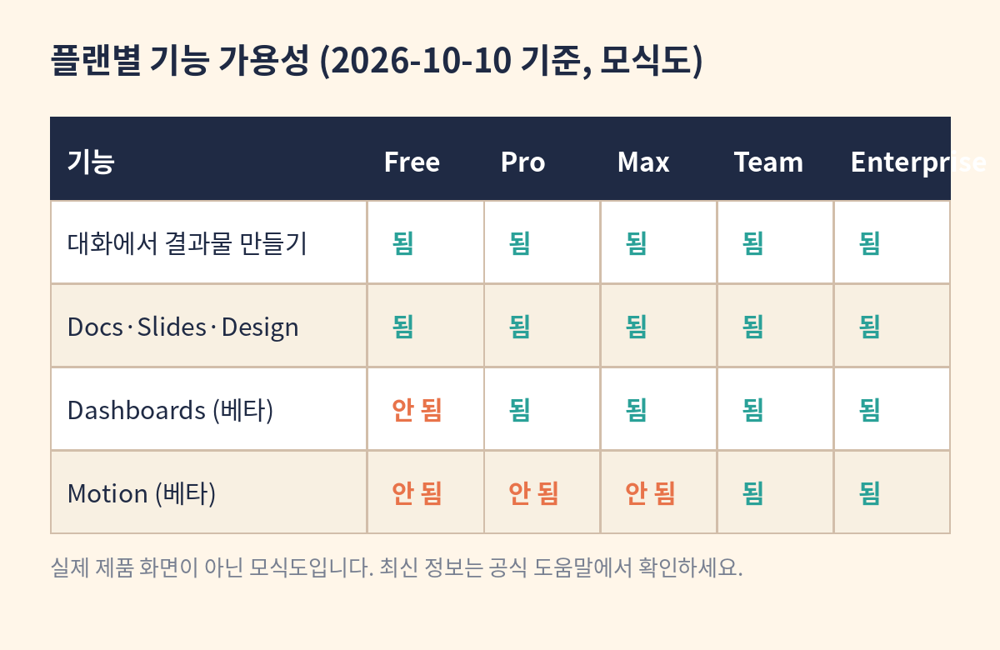

# 2장. 플랜·기능·설정 확인

학습목표: 무료 플랜에서 되는 기능과 유료 베타 기능을 정확히 구분한다.

## 개념

Claude의 결과물 기능은 플랜에 따라 범위가 다릅니다. 이 차이를 모르면 두 가지 실수를 합니다. 안 되는 기능을 된다고 믿고 시간을 쓰거나, 되는 기능을 모르면서 비싼 플랜을 고민하는 것입니다. 두 실수 모두 "내 계정에서 무엇이 보이는가"를 확인하면 피할 수 있습니다.

2026년 10월 10일 기준, 공식 도움말의 기능 표는 다음과 같습니다. 대화에서 Artifact 만들기는 Free·Pro·Max·Team·Enterprise 전 플랜에서 됩니다. Docs·Slides·Design 템플릿으로 시작하기도 전 플랜에서 됩니다. Dashboards 템플릿(베타)은 Pro·Max·Team·Enterprise에서, Motion 템플릿(베타)은 Team·Enterprise에서만 됩니다. 앱 연결과 데이터 저장은 Pro 이상에서 됩니다.

여기에 날짜가 걸린 참고 사항이 있습니다. Docs·Slides·Design은 2026년 10월 15일에 자동 활성화될 예정입니다(HIPAA 적용 조직 제외). 그 전에는 계정이나 조직 설정에서 미리 켜야 할 수 있으니, 안 보이면 설정을 확인하세요. Enterprise에서는 Dashboards와 Motion이 기본적으로 꺼져 있어서 관리자가 조직 설정의 Artifacts 메뉴에서 켜야 합니다.

모든 플랜 공통의 전제 조건도 있습니다. 설정의 Capabilities에서 코드 실행과 파일 생성을 켜야 합니다. 이게 꺼져 있으면 플랜이 Pro여도 결과물이 만들어지지 않습니다. Team·Enterprise에서는 조직 관리자가 조직 설정에서 켭니다. 결과물이 안 나올 때 가장 먼저 의심할 곳입니다.

공유 정책도 플랜마다 다릅니다. 결과물은 기본적으로 나만 볼 수 있습니다. Free·Pro·Max에서는 링크가 있는 사람에게 공유할 수 있고, Team·Enterprise에서는 링크가 조직 내부에만 유효합니다. 외부에 공유하려면 관리자가 외부 공유를 켜야 합니다. 회사 문서를 다룰 때는 이 차이를 알아야 합니다.

기능은 계속 바뀝니다. 이 책의 표는 집필일 기준이므로, 실습 전에 공식 도움말에서 한 번 더 확인하세요. "보이지 않는 기능은 없는 것"으로 실습하는 것이 원칙입니다.

## 언제 쓰는가

- 새 기능을 배우기 전에 내 계정에서 되는지 확인할 때
- 팀에 도입하기 전 플랜별 차이를 정리해야 할 때
- "왜 안 되지?"라는 상황에서 원인을 찾을 때

## 사전 준비

- Claude 계정
- 준비물·기능 확인 장에서 작성한 기능 가용성 점검표

## 단계별 실습

1. Claude 웹 화면에서 Artifacts 탭을 엽니다. 보이는 템플릿 목록을 적습니다.
2. 설정의 Capabilities에서 코드 실행·파일 생성이 켜져 있는지 확인합니다.
3. 아래 표를 채웁니다. 보이는 것은 보임, 안 보이는 것은 안 보임으로 적습니다.
4. 프롬프트 1을 Claude에게 입력하고, 안내가 내 계정 상태와 맞는지 대조합니다.
5. 안 보이는 기능이 있다면, 그 기능을 전제로 한 실습은 건너뛰고 이 책의 무료 대체 경로를 씁니다.

| 기능 | 내 계정 상태 |
| --- | --- |
| Docs·Slides·Design 템플릿 | 보임 / 안 보임 |
| Dashboards 템플릿 (베타) | 보임 / 안 보임 |
| Motion 템플릿 (베타) | 보임 / 안 보임 |
| 코드 실행·파일 생성 | 켜짐 / 꺼짐 |

위 도식은 실제 제품 화면이 아닌 모식도입니다. 실제 화면 미확보.

## 복사해서 쓰는 프롬프트

프롬프트 1 (내 계정 기준 안내 요청):

내 계정에 보이는 기능을 기준으로 문서·슬라이드 실습을 안내해줘. 보이지 않는 기능은 있다고 가정하지 말고 Markdown 대체 방법을 제공해줘.

프롬프트 2 (기능 제한 확인):

내 플랜은 Free야. 대시보드 베타를 쓸 수 있는지, 쓸 수 없다면 같은 목적을 달성할 무료 대체 방법이 무엇인지 알려줘.

## 입력 예시

입력: "내 플랜은 Free야" + 2장의 점검표 결과
출력 기대: Free에서 되는 문서·슬라이드 실습 안내와 대시보드 대체 방법(정적 지표 명세서)

## 성공 예시

점검표가 정확히 채워졌습니다. "내 플랜은 Free, Docs·Slides 템플릿은 보임, Dashboards는 안 보임"이라고 정리했고, 이후 실습에서 대시보드 대신 정적 명세서를 쓰는 대체 경로를 택했습니다. Claude의 안내도 "대시보드 베타는 유료 플랜에서 된다"고 정확히 말했습니다.

## 실패 예시

점검을 건너뛰고 "대시보드 만들어줘"라고 요청했더니 Claude가 만들 수 없다고 답했습니다. 시간을 쓰고 나서야 내 플랜에서는 안 된다는 것을 알았습니다. 또는 반대로, 되는 기능이 있는데도 "유료여야 되겠지"라고 지레짐작하고 시도하지 않았습니다.

## 오류 해결

- 템플릿이 안 보임: 10월 15일 자동 활성화 전이라면 설정에서 직접 켜져 있는지 확인하세요. 그래도 안 보이면 대화에서 직접 "보고서로 만들어줘"처럼 요청하세요.
- Team·Enterprise에서 Motion이 안 보임: 관리자가 조직 설정의 Artifacts 메뉴에서 켜야 합니다. 개인이 켤 수 없습니다.
- 코드 실행·파일 생성을 켰는데도 안 됨: 브라우저를 새로고침하고 다시 확인하세요. Team·Enterprise는 조직 관리자에게 문의하세요.

## 완료 점검

- [ ] 내 플랜에서 되는 기능과 안 되는 기능을 말할 수 있는가?
- [ ] 기능 제한을 공식 도움말 출처와 함께 설명할 수 있는가?
- [ ] 안 되는 기능의 대체 경로를 아는가?

## 확인 문제

1. 다음 중 2026-10-10 기준으로 맞는 것은?
   가. Dashboards 베타는 Free 플랜에서도 된다
   나. Motion 베타는 Team·Enterprise 플랜에서 된다
   다. Docs·Slides·Design은 Pro 이상에서만 된다
   라. 코드 실행·파일 생성은 켜지 않아도 Artifact가 만들어진다
   정답: 나. Dashboards 베타는 유료 플랜(Pro·Max·Team·Enterprise), Motion 베타는 Team·Enterprise에서 됩니다. Docs·Slides·Design은 Free 포함 전 플랜에서 됩니다.

2. Enterprise 조직에서 Dashboards가 안 보일 때 할 일은?
   가. 개인 설정에서 켠다
   나. 관리자에게 조직 설정의 Artifacts 메뉴에서 활성화를 요청한다
   다. Free 플랜으로 바꾼다
   라. 브라우저를 바꾼다
   정답: 나. Enterprise에서는 Dashboards와 Motion이 기본 비활성화이므로 관리자가 켜야 합니다.

## 자주 묻는 질문

Q. 10월 15일 자동 활성화 전에는 Docs·Slides를 못 쓰나요?
A. 계정과 조직 설정에 따라 다릅니다. 보이면 쓰고, 안 보이면 대화에서 직접 요청하는 방식으로 실습하세요. 10월 15일 이후에는 별도 설정 없이 켜집니다(HIPAA 적용 조직 제외).

Q. Free 플랜인데 앱 연결이 안 됩니다.
A. 정상입니다. 앱 연결과 데이터 저장은 Pro 이상에서 됩니다. Free에서는 대화와 파일 첨부로 실습하세요.

## 출처 확인

- Anthropic 공식 발표 (2026-10-08): 베타 범위와 전 플랜 제공
- Claude 공식 도움말 "What are artifacts and how do I use them?" (확인일 2026-10-10): 플랜별 기능 표, Capabilities 설정, 공유 정책
- Claude 공식 제품 페이지 (확인일 2026-10-10): 10월 15일 자동 활성화, Enterprise 기본 비활성화
- 이 책의 도식은 실제 제품 화면이 아닌 모식도입니다. 실제 화면 미확보.
