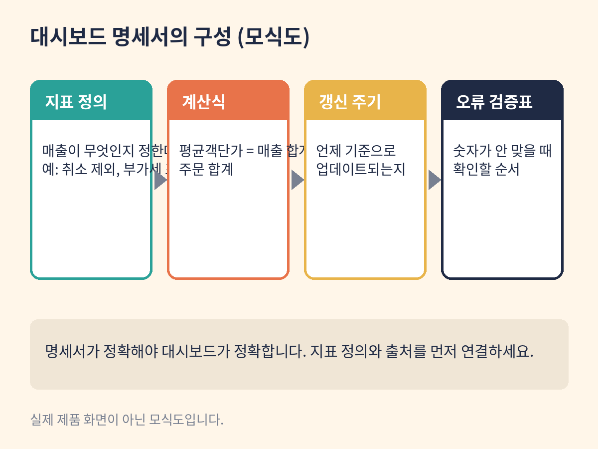

# 6장. 대시보드 설계와 지표 검증

학습목표: 지표 정의·갱신 시각·쿼리 공개의 의미를 이해하고 명세서를 쓴다.

## 개념

대시보드는 숫자를 모아 보여주는 화면입니다. Claude Dashboards는 데이터 플랫폼에 연결해 평이한 질문으로 대시보드를 만들고, 데이터가 바뀌면 최신으로 유지합니다. 숫자를 클릭하면 그 뒤의 쿼리를 볼 수 있고, 각 차트에는 데이터 갱신 시각이 표시됩니다. "이 숫자가 어디서 왔는가"를 보여주는 것이 핵심 기능입니다.

다만 이 장을 읽는 대부분의 독자는 당장 쓸 수 없습니다. Dashboards 베타는 유료 플랜(Pro·Max·Team·Enterprise)에서만 되고, Enterprise에서는 관리자가 켜야 합니다. 그래서 이 장의 목표는 "만들기"가 아니라 "이해하기"입니다. 대시보드를 설계할 때 필요한 지표 정의, 계산식, 갱신 주기, 오류 검증표를 명세서로 쓰는 법을 익힙니다. 명세서는 무료 플랜에서도 쓸 수 있고, 나중에 유료 플랜에서 실제 대시보드를 만들 때 그대로 씁니다.

지표 정의가 왜 중요한지 예를 들어 보겠습니다. "매출"이라는 지표는 정의가 없으면 아무 의미가 없습니다. 취소 주문을 뺀 것인가, 부가세를 포함한 것인가. 대시보드는 이런 정의를 각 차트에 붙입니다. 갱신 시각도 마찬가지입니다. "어제 기준"인지 "실시간"인지에 따라 숫자의 의미가 달라집니다. 쿼리 공개는 검증의 수단입니다. 숫자를 클릭하면 SQL 같은 쿼리가 보여서, 계산이 맞는지 확인할 수 있습니다.

데이터 연결도 알아둡시다. Dashboards는 Redshift, BigQuery, ClickHouse, Databricks, Snowflake 같은 데이터 플랫폼과 Salesforce 같은 커넥터에 연결됩니다. 더 깊은 분석이 필요하면 Amplitude, Grafana, Mixpanel, Omni, PostHog, Sigma 같은 BI 도구로 보낼 수 있습니다. 대시보드가 BI 도구를 대체하는 것이 아니라, 빠른 질문에 답하는 용도라는 것이 공식 설명입니다.

실데이터 주의사항도 여기서 다룹니다. 실데이터를 연결하기 전에는 세 가지를 확인하세요. 개인정보가 포함되어 있는가, 내가 접근 권한이 있는 데이터인가, 계산 결과가 검증됐는가. 이 책의 실습은 가상 데이터로만 합니다.

## 언제 쓰는가

- 지표의 정의와 계산식을 문서로 정리해야 할 때
- 대시보드 도입 전에 무엇이 필요한지 파악할 때 (유료 플랜 검토용)
- 실데이터 연결 전 검증 체계를 만들 때

## 사전 준비

- 4장의 가상 CSV와 검산 결과 (같은 데이터를 씁니다)
- 2장의 기능 점검표 (대시보드 베타가 보이는지 확인)

## 단계별 실습

1. 2장의 점검표에서 Dashboards 베타가 보이는지 확인합니다. 안 보이면 이 장은 명세서 실습으로 진행합니다.
2. 프롬프트 1을 입력해 가상 주문 데이터의 대시보드 명세서를 작성합니다.
3. 명세서의 지표 정의(매출, 주문수, 평균객단가)가 4장의 검산값과 연결되는지 확인합니다.
4. 계산식, 갱신 주기, 오류 검증표가 포함됐는지 확인합니다.
5. 유료 플랜에서 확인: 베타가 보이면 테스트 연결을 해보고, 숫자를 클릭해 쿼리가 보이는지 확인합니다.

위 도식은 실제 제품 화면이 아닌 모식도입니다. 실제 화면 미확보.

## 복사해서 쓰는 프롬프트

프롬프트 1 (대시보드 명세서):

가상 주문 데이터의 매출·주문수·평균객단가를 보여줄 대시보드 명세서를 작성해줘. 지표 정의, 계산식, 갱신 주기, 오류 검증표를 포함해줘.

[가상 데이터: 4장의 CSV 10행. 합계 426건, 12,780,000원, 평균객단가 30,000원. 모두 가상]

프롬프트 2 (유료 플랜에서 확인):

우리 팀은 Pro 플랜이야. 가상 주문 데이터를 연결한 테스트 대시보드를 만들어줘. 각 숫자를 클릭하면 쿼리가 보이게 하고, 갱신 시각을 표시해줘.

## 입력 예시

입력: 4장의 가상 CSV + 합계·평균 검산값
출력 기대: 지표 정의·계산식·갱신 주기·오류 검증표가 담긴 대시보드 명세서 문서

## 성공 예시

명세서에 "평균객단가 = 매출 합계 12,780,000원(가상) / 주문 합계 426건(가상) = 30,000원(가상)"이라고 계산식이 적혀 있습니다. 갱신 주기는 "매일 오전 9시"로, 오류 검증표에는 "주문건수 합계가 426건이 아니면 원본 CSV 확인"이라고 적혀 있습니다. 지표 정의와 출처가 연결됩니다.

## 실패 예시

"평균객단가 약 3만원"으로만 적혀 있고 계산식이 없습니다. 갱신 주기가 없고, 오류가 나면 어떻게 할지 적혀 있지 않습니다. 이런 명세서로는 대시보드를 만들 수 없습니다.

## 오류 해결

- 베타가 안 보임: 유료 플랜인지, Enterprise라면 관리자가 켰는지 확인하세요. 안 되면 명세서 실습으로 진행합니다.
- 지표 정의가 모호함: "취소 주문 포함 여부" 같은 경계 조건을 프롬프트에 추가하세요.
- 숫자가 안 맞음: 4장의 검산값으로 돌아가세요. 명세서의 숫자는 검산된 값만 씁니다.

## 완료 점검

- [ ] 지표 정의와 출처(4장 데이터)가 연결되는가?
- [ ] 계산식·갱신 주기·오류 검증표가 있는가?
- [ ] 실데이터 주의사항(개인정보·권한·검증)을 아는가?

## 확인 문제

1. 대시보드에서 숫자를 클릭하면 쿼리가 보이는 이유는?
   가. 화면을 예쁘게 만들기 위해
   나. 숫자의 출처를 검증할 수 있게 하기 위해
   다. 쿼리를 외우게 하기 위해
   라. 속도를 빠르게 하기 위해
   정답: 나. 쿼리 공개는 "이 숫자가 어디서 왔는가"를 보여주는 검증 수단입니다.

2. 이 책에서 무료 플랜 독자가 대시보드 장을 실습하는 방법은?
   가. 실습을 건너뛴다
   나. 정적 대시보드 명세서를 작성한다
   다. 유료 플랜을 결제한다
   라. 다른 사람 계정을 빌린다
   정답: 나. 명세서는 무료 플랜에서도 쓸 수 있고, 나중에 실제 대시보드를 만들 때 그대로 씁니다.

## 자주 묻는 질문

Q. Dashboards가 BI 도구를 대체하나요?
A. 아닙니다. 공식 설명에 따르면 빠른 질문에 답하는 용도이며, 깊은 분석은 Amplitude, Grafana 같은 기존 BI 도구로 보냅니다.

Q. 실데이터를 연결해도 되나요?
A. 개인정보·접근 권한·계산 검증을 확인한 뒤에 하세요. 조직의 보안 정책을 먼저 확인하는 것이 우선입니다.

## 출처 확인

- Anthropic 공식 발표 (2026-10-08): Dashboards 베타의 유료 플랜 제공, 데이터 플랫폼 연결
- Claude 공식 제품 페이지 (확인일 2026-10-10): 쿼리 공개, 갱신 시각, BI 도구 핸드오프 목록
- Claude 공식 도움말 (확인일 2026-10-10): 플랜별 기능 표
- 예제 데이터와 수치는 모두 가상입니다
- 이 책의 도식은 실제 제품 화면이 아닌 모식도입니다. 실제 화면 미확보.
