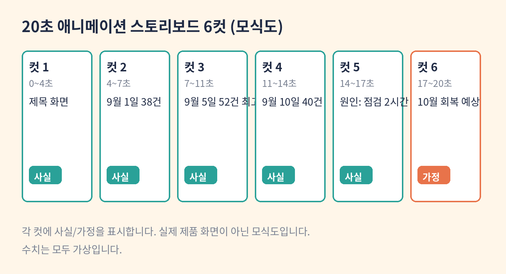

# 7장. 모션 스토리보드와 내보내기

학습목표: 코드 기반 애니메이션과 생성 영상의 차이를 이해한다.

## 개념

Claude Motion은 보고서나 차트를 짧은 애니메이션으로 바꿉니다. 30초짜리 분기 보고서 설명 같은 것입니다. 중요한 점은 이것이 영상을 생성하는 AI가 아니라는 것입니다. Claude는 텍스트, 차트, 도형, 이미지와 타이밍을 코드로 짭니다. 그래서 단어 하나, 숫자 하나, 타이밍을 모두 고칠 수 있습니다. 완성되면 MP4로 내보내고, Adobe, Descript, HeyGen, Higgsfield, invideo, Luma AI, Runway 같은 도구에서 이어서 작업할 수 있습니다.

"코드로 짠다"는 말의 의미를 풀어보겠습니다. 일반 영상 생성 AI는 프롬프트를 주면 영상을 통째로 만들어냅니다. 마음에 안 드는 부분을 고치려면 다시 만들어야 합니다. 반면 Motion은 각 요소가 코드로 되어 있어서 "3초 부분의 숫자를 426으로 바꿔줘"라고 하면 그 부분만 바뀝니다. 생성된 장면이 아니라 조립된 장면입니다. 그래서 AI가 만든 가짜 인물이 나올 걱정도 없습니다.

이 장을 읽는 대부분의 독자는 당장 쓸 수 없습니다. Motion 베타는 Team·Enterprise 플랜에서만 됩니다. 그래서 이 장의 목표도 "이해하기"입니다. 애니메이션을 만들기 전에 쓰는 스토리보드를 6컷으로 쓰는 법을 익힙니다. 스토리보드는 무료 플랜에서도 쓸 수 있는 문서이며, 나중에 Motion을 쓸 때 그대로 대본이 됩니다. 영상이 없어도 핵심을 전달할 수 있어야 좋은 스토리보드입니다.

스토리보드를 쓸 때 사실과 가정을 분리하세요. "9월 주문 426건(가상)"은 데이터에 있는 사실이고, "10월에 회복될 것이다"는 가정입니다. 애니메이션은 말이 빠르기 때문에 사실과 가정이 섞이면 검증 없이 퍼집니다. 6컷 각각에 사실인지 가정인지 표시하는 습관을 들이세요.

## 언제 쓰는가

- 보고서의 핵심 변화를 짧게 설명해야 할 때
- Motion 도입 전에 애니메이션 기획을 문서로 정리할 때 (유료 플랜 검토용)
- 발표용 짧은 영상의 대본이 필요할 때

## 사전 준비

- 4장의 가상 CSV 요약과 6장의 대시보드 명세서 (스토리보드 소재)
- 2장의 기능 점검표 (Motion 베타가 보이는지 확인)

## 단계별 실습

1. 2장의 점검표에서 Motion 베타가 보이는지 확인합니다. 안 보이면 스토리보드 실습으로 진행합니다.
2. 4장의 수치 중 애니메이션으로 보여줄 전후 변화를 고릅니다. (예: 9월 초 38건 → 9월 5일 52건, 가상)
3. 프롬프트 1을 입력해 6컷 스토리보드를 씁니다.
4. 각 컷에 사실과 가정을 분리해서 표시했는지 확인합니다.
5. 유료 플랜에서 확인: 베타가 보이면 스토리보드를 Motion으로 만들어보고, 숫자를 고쳐 MP4로 내보냅니다.

위 도식은 실제 제품 화면이 아닌 모식도입니다. 실제 화면 미확보.

## 복사해서 쓰는 프롬프트

프롬프트 1 (스토리보드 작성):

가상 프로젝트의 전후 변화 수치를 설명하는 20초짜리 애니메이션 스토리보드를 6컷으로 써줘. 사실과 가정은 분리해줘.

[가상 수치: 9월 1일 38건 → 9월 5일 52건 → 9월 10일 40건. 모두 가상. 10월 회복은 가정]

프롬프트 2 (유료 플랜에서 확인):

위 스토리보드를 Motion으로 만들어줘. 3컷의 숫자를 52건으로 고정하고, 완성되면 MP4로 내보낼 수 있게 해줘.

## 입력 예시

입력: 4장의 가상 수치 + 전후 변화 지점
출력 기대: 6컷 스토리보드. 각 컷에 화면 설명, 자막, 시간, 사실/가정 표시

## 성공 예시

6컷 각각에 "화면: 막대 그래프 상승", "자막: 9월 5일 52건으로 최고치(가상, 사실)", "시간: 0~4초"처럼 적혀 있습니다. 마지막 컷의 "10월에는 일평균 43건 회복 예상"에는 "(가정)" 표시가 있습니다. 영상이 없어도 핵심이 전달됩니다.

## 실패 예시

"주문이 늘었다"는 말만 있고 수치가 없습니다. 사실과 가정이 섞여 있어서 어디까지가 확인된 것인지 모릅니다. 컷 구분이 없어서 20초 분량인지 알 수 없습니다. 이런 스토리보드로는 애니메이션을 만들 수 없습니다.

## 오류 해결

- 베타가 안 보임: Team·Enterprise 플랜인지, 관리자가 켰는지 확인하세요. 안 되면 스토리보드 문서로 실습합니다.
- 컷이 너무 김: "20초, 6컷으로"라고 시간과 컷 수를 명시하세요.
- 사실과 가정이 섞임: "각 컷 끝에 (사실) 또는 (가정)을 붙여줘"를 추가하세요.

## 완료 점검

- [ ] 6컷으로 20초 분량이 나오는가?
- [ ] 영상이 없어도 핵심이 전달되는가?
- [ ] 사실과 가정이 분리됐는가?

## 확인 문제

1. Claude Motion이 일반 영상 생성 AI와 다른 점은?
   가. 더 긴 영상을 만든다
   나. 텍스트·차트·도형을 코드로 짜서 단어·숫자·타이밍을 각각 고칠 수 있다
   다. AI 인물을 생성한다
   라. 무료 플랜에서 된다
   정답: 나. 코드 기반이라 부분 수정이 되고, 생성된 장면이 아니라 조립된 장면입니다.

2. 스토리보드에 사실과 가정을 분리하는 이유는?
   가. 컷 수를 맞추기 위해
   나. 애니메이션은 말이 빨라서 사실과 가정이 섞이면 검증 없이 퍼지기 때문에
   다. MP4 용량을 줄이기 위해
   라. 자막을 예쁘게 쓰기 위해
   정답: 나. 특히 수치 전달에서는 사실과 가정의 분리가 신뢰의 기본입니다.

## 자주 묻는 질문

Q. Motion으로 만든 것을 어디서 이어서 작업하나요?
A. MP4로 내보내 Adobe, Descript, HeyGen, Higgsfield, invideo, Luma AI, Runway 같은 도구에서 열 수 있습니다. Canva와 Captions 지원은 예정되어 있습니다.

Q. 무료 플랜인데 스토리보드만으로 충분한가요?
A. 기획 단계에서는 충분합니다. 스토리보드는 Motion의 대본이 되므로, 나중에 유료 플랜에서 만들 때 그대로 씁니다.

## 출처 확인

- Anthropic 공식 발표 (2026-10-08): Motion 베타의 Team·Enterprise 제공
- Claude 공식 제품 페이지 (확인일 2026-10-10): 코드 기반 애니메이션, MP4 내보내기, 연동 도구 목록
- Claude 공식 도움말 (확인일 2026-10-10): 플랜별 기능 표
- 예제 시나리오와 수치는 모두 가상입니다
- 이 책의 도식은 실제 제품 화면이 아닌 모식도입니다. 실제 화면 미확보.
