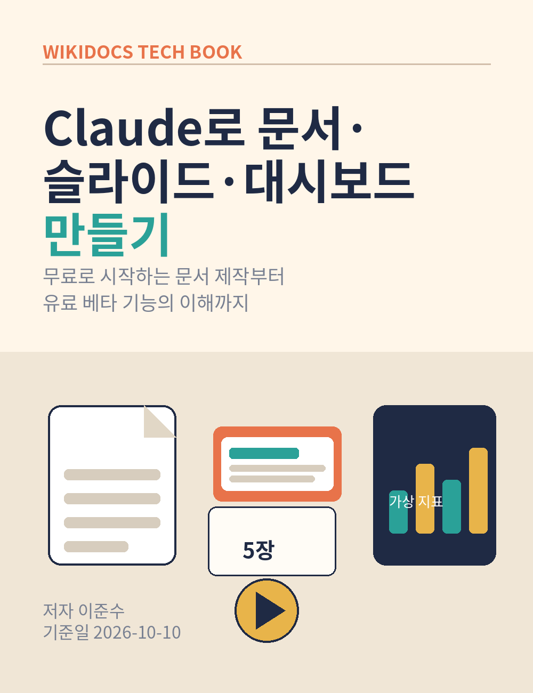

# Claude로 문서·슬라이드·대시보드 만들기

무료로 시작하는 문서 제작부터 유료 베타 기능의 이해까지

저자: 이준수
문의: 1130dlwltn2@gmail.com
인공지능 정보공유 단톡방: https://open.kakao.com/o/s4OEqBai

이 책의 모든 실습은 가상의 데이터로 진행합니다. 실제 업무 데이터를 넣기 전에는 7장의 검증 원칙과 개인정보 주의사항을 먼저 읽어주세요.
